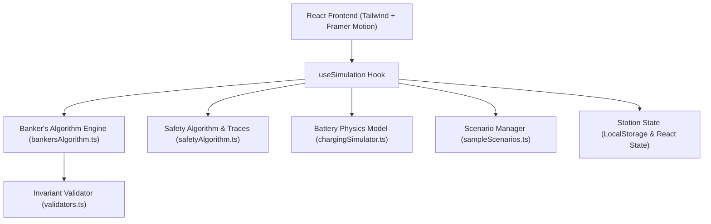

# Smart EV Charging Station: Deadlock Prevention & Intelligent Resource Allocation Using Banker's Algorithm

[](https://vitest.dev/)
[](https://react.dev/)
[](https://www.typescriptlang.org/)
[](https://tailwindcss.com/)
[](#academic-disclaimer)

> **Academic Operating Systems Capstone Project**  
> An interactive, visual simulation demonstrating the practical application of **Edsger Dijkstra's Banker's Algorithm** for deadlock avoidance within smart electric vehicle (EV) charging microgrids.

---

## 1. Executive Summary & Problem Statement

As electric vehicles (EVs) rapidly proliferate, commercial charging hubs face acute physical and electrical bottlenecks:
1. **Limited physical parking bays and charging plugs ($R_1$)** — Mutual exclusion over spatial hookups.
2. **Constrained electrical power and transformer substation capacity ($R_2$)** — Shared feeder line limits.

When multiple EVs arrive and compete for these limited resources, **naive or first-come, first-served (FCFS) allocation strategies create severe vulnerabilities**:
- A vehicle holding a charging port may request additional power during fast charging.
- If the station blindly allocates available power without verifying future claims, other connected vehicles may stall waiting for power while continuing to block their physical ports.
- This creates an **Unsafe State**, which risks devolving into an active **Deadlock** (circular hold-and-wait). In high-voltage grids, this causes vehicle stalls, service outages, or trips transformer circuit breakers.

### The Banker's Algorithm Solution
This simulator implements **Banker's Algorithm** as the central decision-making engine:
> *"Before granting any resource request, the station tentatively simulates the allocation and mathematically verifies whether a **Safe Sequence** exists under the declared maximum claims of all connected vehicles. If no safe sequence exists, the request is immediately rejected, the tentative allocation is rolled back, and the station remains safe."*

---

## 2. Real-World Relevance: Why Banker's Algorithm for EV Charging?

While Banker's Algorithm is traditionally taught using abstract operating system processes and tape drives, modern EV charging hubs represent a direct cyber-physical implementation:

| Operating System Concept | Smart EV Charging Infrastructure Mapping |
|---|---|
| **Process ($P_i$)** | Connected Electric Vehicle (e.g. `Voltix Cypher GT`, `AeroPulse HyperTourer`) |
| **Resource Type 1 ($R_1$)** | Physical Charging Bays / Plugs (Discrete ports, integer count) |
| **Resource Type 2 ($R_2$)** | Electrical Power Capacity (Discrete 10 kW units, e.g., $12 \times 10\text{ kW} = 120\text{ kW}$) |
| **Maximum Claim ($Max_i$)** | Declared peak power acceptance negotiated via **ISO 15118 / CCS handshake** |
| **Current Allocation ($Alloc_i$)** | Port occupied + Active kW delivered by the DC fast charger rectifier |
| **Dynamic Need ($Need_i$)** | Remaining power claim: $\text{Need}_i = \text{Max}_i - \text{Allocation}_i$ |
| **Available Pool ($Available$)** | Free bays + unallocated transformer capacity |
| **Process Completion** | Battery reaches target State of Charge (SOC); vehicle disconnects |
| **Deadlock** | Grid deadlock: vehicles occupying ports waiting for power, while other bays starve |

---

## 3. Core Banker's Algorithm Matrices Explained

The station models $n$ active vehicles and $m = 2$ discrete resource types:
- **Resource 1 ($R_1$)**: Charging Ports (Total = 4)
- **Resource 2 ($R_2$)**: Electrical Power in discrete 10 kW units (Total = 12 units = 120 kW)

### 1. Available Vector $[1 \times m]$
A 1D vector of length $m$ representing the number of unallocated resources currently available in the station reservoir:
$$\text{Available} = [A_1, A_2]$$
- $A_1$: Number of currently unoccupied charging bays.
- $A_2$: Number of unallocated power units ($10\text{ kW}$ each).

### 2. Maximum Claim Matrix ($Max$) $[n \times m]$
An $n \times m$ matrix defining the maximum claim of each vehicle negotiated during the ISO 15118 handshake prior to entering active service:
$$Max[i][j] = \text{Maximum units of resource } j \text{ that vehicle } i \text{ may demand}$$

### 3. Allocation Matrix ($Alloc$) $[n \times m]$
An $n \times m$ matrix defining the resources currently assigned to each vehicle:
$$Alloc[i][j] = \text{Units of resource } j \text{ currently allocated to vehicle } i$$

### 4. Dynamic Need Matrix ($Need$) $[n \times m]$
An $n \times m$ matrix calculated dynamically to represent the remaining resources each vehicle may claim before completing:
$$\boxed{Need[i][j] = Max[i][j] - Alloc[i][j]}$$
*Note: In this simulator, Need is never hardcoded; it is computed dynamically on every state transition.*

### 5. System Invariant Law
At all times (before requests, post-allocation, post-rollback, and post-completion), the conservation law must strictly hold:
$$\boxed{\text{Total}[j] = \text{Available}[j] + \sum_{i=0}^{n-1} Alloc[i][j] \quad (\forall j \in \{1, \dots, m\})}$$

---

## 4. Complete Step-by-Step Worked Mathematical Example

Let us examine the exact mathematical execution of the simulator using the baseline fleet.

### Station Baseline Configuration:
- **Total Charging Ports ($R_1$)**: 4
- **Total Electrical Power ($R_2$)**: 120 kW = 12 discrete units (1 unit = 10 kW)
- **$\text{Total Vector}$**: $[4, 12]$

### Initial Vehicle State:
Suppose 4 vehicles are registered in the station:

| Vehicle | Model | $Max$ [Ports, Power] | $Alloc$ [Ports, Power] | Dynamic $Need$ ($Max - Alloc$) | Status |
|---|---|:---:|:---:|:---:|:---:|
| **EV-01** | Voltix Cypher GT | $[1, 4]$ ($40\text{ kW}$) | $[1, 2]$ ($20\text{ kW}$) | $[1-1, 4-2] = \mathbf{[0, 2]}$ ($20\text{ kW}$) | Charging (Bay 1) |
| **EV-02** | AeroPulse Tourer | $[1, 5]$ ($50\text{ kW}$) | $[1, 3]$ ($30\text{ kW}$) | $[1-1, 5-3] = \mathbf{[0, 2]}$ ($20\text{ kW}$) | Charging (Bay 2) |
| **EV-03** | Electra Zephyr S | $[1, 3]$ ($30\text{ kW}$) | $[1, 1]$ ($10\text{ kW}$) | $[1-1, 3-1] = \mathbf{[0, 2]}$ ($20\text{ kW}$) | Charging (Bay 3) |
| **EV-04** | TerraWatt Apex | $[1, 4]$ ($40\text{ kW}$) | $[0, 0]$ ($0\text{ kW}$) | $[1-0, 4-0] = \mathbf{[1, 4]}$ ($40\text{ kW}$) | Waiting in Queue |

#### Step A: Calculate Initial Available Vector
$$\sum Alloc = [1+1+1+0, \ 2+3+1+0] = [3, 6]$$
$$\text{Available} = \text{Total} - \sum Alloc = [4 - 3, \ 12 - 6] = \mathbf{[1, 6]} \quad (1\text{ port, } 60\text{ kW})$$

#### Step B: Check Initial System Safety
1. Initialize $\text{Work} = \text{Available} = [1, 6]$.
2. Initialize $\text{Finish} = [\text{false}, \text{false}, \text{false}, \text{false}]$.

- **Iteration 1**:
  - Test EV-01: Is $\text{Need}_1 \le \text{Work}$? $\to [0, 2] \le [1, 6]$? **YES**.
  - EV-01 can complete:
    $$\text{Work} = \text{Work} + Alloc_1 = [1, 6] + [1, 2] = \mathbf{[2, 8]}$$
    $$\text{Finish}[\text{EV-01}] = \text{true}$$
    $$\text{SafeSequence} = [\text{EV-01}]$$

- **Iteration 2**:
  - Test EV-02: Is $\text{Need}_2 \le \text{Work}$? $\to [0, 2] \le [2, 8]$? **YES**.
  - EV-02 can complete:
    $$\text{Work} = \text{Work} + Alloc_2 = [2, 8] + [1, 3] = \mathbf{[3, 11]}$$
    $$\text{Finish}[\text{EV-02}] = \text{true}$$
    $$\text{SafeSequence} = [\text{EV-01}, \text{EV-02}]$$

- **Iteration 3**:
  - Test EV-03: Is $\text{Need}_3 \le \text{Work}$? $\to [0, 2] \le [3, 11]$? **YES**.
  - EV-03 can complete:
    $$\text{Work} = \text{Work} + Alloc_3 = [3, 11] + [1, 1] = \mathbf{[4, 12]}$$
    $$\text{Finish}[\text{EV-03}] = \text{true}$$
    $$\text{SafeSequence} = [\text{EV-01}, \text{EV-02}, \text{EV-03}]$$

- **Iteration 4**:
  - Test EV-04: Is $\text{Need}_4 \le \text{Work}$? $\to [1, 4] \le [4, 12]$? **YES**.
  - EV-04 can complete:
    $$\text{Work} = \text{Work} + Alloc_4 = [4, 12] + [0, 0] = \mathbf{[4, 12]}$$
    $$\text{Finish}[\text{EV-04}] = \text{true}$$
    $$\text{SafeSequence} = [\text{EV-01}, \text{EV-02}, \text{EV-03}, \text{EV-04}]$$

**Result**: All $\text{Finish}[i] == \text{true}$. The baseline system is **SAFE**.

---

### Step C: Worked Example of a Safe Resource Request
Suppose **EV-04 requests $[1, 3]$** (1 port and $30\text{ kW}$):

1. **Check 1: $\text{Request} \le \text{Need}_4$**:
   $[1, 3] \le [1, 4] \implies \mathbf{TRUE}$. (Valid claim)
2. **Check 2: $\text{Request} \le \text{Available}$**:
   $[1, 3] \le [1, 6] \implies \mathbf{TRUE}$. (Resources currently in pool)
3. **Check 3: Tentative Allocation**:
   $$\text{Available}' = [1, 6] - [1, 3] = \mathbf{[0, 3]}$$
   $$Alloc_4' = [0, 0] + [1, 3] = \mathbf{[1, 3]}$$
   $$Need_4' = [1, 4] - [1, 3] = \mathbf{[0, 1]}$$
4. **Check 4: Run Safety Algorithm on Tentative State**:
   - $\text{Work} = [0, 3]$
   - Test EV-01: $\text{Need}_1 = [0, 2] \le [0, 3] \implies \mathbf{TRUE}$.
     $\text{Work} = [0, 3] + [1, 2] = [1, 5]$. $\text{Finish}[\text{EV-01}] = \text{true}$.
   - Test EV-02: $\text{Need}_2 = [0, 2] \le [1, 5] \implies \mathbf{TRUE}$.
     $\text{Work} = [1, 5] + [1, 3] = [2, 8]$. $\text{Finish}[\text{EV-02}] = \text{true}$.
   - Test EV-03: $\text{Need}_3 = [0, 2] \le [2, 8] \implies \mathbf{TRUE}$.
     $\text{Work} = [2, 8] + [1, 1] = [3, 9]$. $\text{Finish}[\text{EV-03}] = \text{true}$.
   - Test EV-04: $\text{Need}_4 = [0, 1] \le [3, 9] \implies \mathbf{TRUE}$.
     $\text{Work} = [3, 9] + [1, 3] = [4, 12]$. $\text{Finish}[\text{EV-04}] = \text{true}$.
5. **Check 5: Final Decision**:
   - Safe sequence exists: $\mathbf{\text{EV-01} \to \text{EV-02} \to \text{EV-03} \to \text{EV-04}}$.
   - **PERMANENTLY COMMIT ALLOCATION**. EV-04 enters Bay 4 and begins charging.

---

### Step D: Worked Example of Unsafe State Prevention (Deadlock Avoidance)
This is the single most important demonstration of the project.

Suppose the station has an available capacity of $\text{Available} = \mathbf{[1, 2]}$ ($1\text{ port, } 20\text{ kW}$).
The fleet state is:
- **EV-01**: $Alloc = [1, 3]$, $Max = [1, 5] \implies \mathbf{Need = [0, 2]}$
- **EV-02**: $Alloc = [1, 3]$, $Max = [1, 5] \implies \mathbf{Need = [0, 2]}$
- **EV-03**: $Alloc = [1, 3]$, $Max = [1, 5] \implies \mathbf{Need = [0, 2]}$
- **EV-04**: $Alloc = [0, 0]$, $Max = [1, 3] \implies \mathbf{Need = [1, 3]}$

Now, **EV-04 submits a request for $[1, 2]$** (1 port and $20\text{ kW}$):
1. **Check 1: $\text{Request} \le Need_4$**: $[1, 2] \le [1, 3] \implies \mathbf{TRUE}$.
2. **Check 2: $\text{Request} \le Available$**: $[1, 2] \le [1, 2] \implies \mathbf{TRUE}$.
   > *A naive FCFS scheduler would immediately grant this request because resources are available right now!*
3. **Check 3: Tentative Allocation**:
   $$\text{Available}' = [1, 2] - [1, 2] = \mathbf{[0, 0]}$$
   $$Alloc_4' = [0, 0] + [1, 2] = [1, 2]$$
   $$Need_4' = [1, 3] - [1, 2] = [0, 1]$$
4. **Check 4: Run Safety Algorithm**:
   - $\text{Work} = [0, 0]$
   - Can EV-01 finish? $\text{Need}_1 = [0, 2] \le [0, 0]$? **NO!** (Stalled for power)
   - Can EV-02 finish? $\text{Need}_2 = [0, 2] \le [0, 0]$? **NO!** (Stalled for power)
   - Can EV-03 finish? $\text{Need}_3 = [0, 2] \le [0, 0]$? **NO!** (Stalled for power)
   - Can EV-04 finish? $\text{Need}_4 = [0, 1] \le [0, 0]$? **NO!** (Stalled for power)
   - **NO VEHICLE CAN SATISFY $\text{Need} \le \text{Work}$!**
   - System enters an **UNSAFE STATE**.
5. **Check 5: Automatic Rollback & Rejection**:
   - Banker's Algorithm **REJECTS** the request.
   - Tentative allocation is **ROLLED BACK**:
     $$\text{Available} \text{ restored to } [1, 2]$$
     $$Alloc_4 \text{ restored to } [0, 0]$$
     $$Need_4 \text{ restored to } [1, 3]$$
   - EV-04 is placed in the waiting queue with notification: *"Request rejected: granting it would leave the station in an unsafe state (potential deadlock under worst-case demands)."*

---

## 5. Predefined Simulation Scenarios

| Scenario | Objective | Initial Available | Action | Outcome |
|---|---|:---:|---|---|
| **Scenario A: Normal Safe Allocation** | Demonstrate safe sequence discovery and permanent allocation. | $[1, 6]$ ($60\text{ kW}$) | EV-04 requests $[1, 3]$ ($30\text{ kW}$) | **APPROVED (SAFE)** $\to \text{EV-01} \to \text{EV-02} \dots$ |
| **Scenario B: Unsafe State Prevention** | Demonstrate why checking Available alone is insufficient and observe automatic rollback. | $[1, 2]$ ($20\text{ kW}$) | EV-04 requests $[1, 2]$ ($20\text{ kW}$) | **REJECTED (UNSAFE)** $\to$ Rolled back to $[1, 2]$. |
| **Scenario C: Severe Resource Shortage** | Demonstrate waiting queue deferral without running unnecessary safety checks. | $[0, 1]$ ($10\text{ kW}$) | EV-05 requests $[1, 2]$ ($20\text{ kW}$) | **DEFERRED (WAITING)** $\to \text{Request} > \text{Available}$. |
| **Scenario D: Dynamic Completion & Recovery** | Demonstrate resource release upon reaching target SOC and automatic queue reconciliation. | $[0, 1]$ ($10\text{ kW}$) | EV-01 completes charging ($100\%$ SOC) | **RELEASED & RECOVERED** $\to$ Frees port, admits EV-05. |
| **Classic Silberschatz Problem** | Verify against the university textbook benchmark with 3 resources. | $[3, 3, 2]$ | Baseline evaluation of $P_0$–$P_4$ | **SAFE** ($P_1 \to P_3 \to P_4 \to P_0 \to P_2$). |

---

## 6. Software Architecture



### Directory Structure:
```
src/
├── types/
│   └── simulation.ts          # Core interfaces (EV, Station, Matrices, SafetyStep)
├── engine/
│   ├── bankersAlgorithm.ts    # Mathematical Banker's engine & classic solver
│   ├── safetyAlgorithm.ts     # Iteration-by-iteration trace generator
│   └── chargingSimulator.ts   # Battery charging physics (kWh = kW * dt)
├── data/
│   ├── sampleVehicles.ts      # 6 realistic sample EV specifications
│   ├── sampleScenarios.ts     # Pre-configured test scenarios (A, B, C, D)
│   └── educationalContent.ts  # Academic theory, Coffman conditions, quiz questions
├── hooks/
│   └── useSimulation.ts       # Simulation timer loop, tick logic, and event handlers
├── components/
│   ├── Navbar/Header.tsx      # System state badge, invariant flag, speed controls
│   ├── Dashboard/             # Metric cards & real-time decision logs
│   ├── EVStation/             # Top-down visualizer (4 bays, transformer, animated cables)
│   ├── AllocationMatrix/      # 4 matrices table (Available, Max, Alloc, Need) with kW toggle
│   ├── SafeSequence/          # Connected sequence flowchart & step-by-step inspector
│   ├── RequestModal/          # Dedicated request workbench & 5-check decision pipeline
│   ├── ScenarioSelector/      # Scenario runner with 1-click test triggers
│   ├── Charts/                # Recharts telemetry (power over time, bay occupancy)
│   ├── Learn/                 # OS textbook curriculum & interactive student quiz
│   └── Modals/                # Register new EV & reconfigure station capacity
└── test/
    └── bankersAlgorithm.test.ts # Vitest suite with classic [3,3,2] benchmark
```

---

## 7. Battery Physics Simulation Model

The physical battery charging simulation runs in parallel with the resource allocation model:

$$\Delta E = P_{\text{allocated}} \times \left(\frac{\Delta t \times \text{SpeedMultiplier}}{3600}\right) \quad [\text{kWh}]$$

$$\text{SOC}_{\text{new}} = \min\left(\text{TargetSOC}, \ \text{SOC}_{\text{current}} + \frac{\Delta E}{\text{BatteryCapacity}_{\text{kWh}}} \times 100\%\right)$$

### Automatic Resource Deallocation:
When $\text{SOC}_{\text{new}} \ge \text{TargetSOC}$:
1. Vehicle status transitions to `completed`.
2. Station deallocates resources:
   $$\text{Available} = \text{Available} + Alloc[i]$$
   $$Alloc[i] = [0, 0]$$
3. Physical bay is marked vacant.
4. System automatically awakens waiting queue and runs Banker's Algorithm on deferred vehicles.

---

## 8. Installation & Execution Guide

### Prerequisites
- **Node.js**: $\ge 18.x$
- **npm**: $\ge 9.x$

### Step 1: Install Dependencies
```powershell
npm install
```

### Step 2: Run Automated Unit Tests
```powershell
npm test
```
*Executes all 11 unit tests in Vitest verifying classic textbook problems, matrix calculations, invariant preservation, and rollback mechanics.*

### Step 3: Launch Local Development Server
```powershell
npm run dev
```
Open **[http://localhost:5173](http://localhost:5173)** in your browser.

### Step 4: Build for Production
```powershell
npm run build
npm run preview
```

---

## 9. Hosting on GitHub Pages

The project is pre-configured with **relative asset paths (`base: './'`)** in `vite.config.ts`, ensuring it works on any GitHub repository subpath without 404 errors.

### Method A: Automated GitHub Actions (Recommended)
1. Initialize git and push your repository to GitHub:
   ```powershell
   git init
   git add .
   git commit -m "Deploy Smart EV Charging Station"
   git branch -M main
   git remote add origin https://github.com/<YOUR_USERNAME>/<YOUR_REPOSITORY>.git
   git push -u origin main
   ```
2. In your GitHub repository:
   - Go to **Settings** $\to$ **Pages**
   - Under **Build and deployment** $\to$ **Source**, choose **GitHub Actions**
3. The workflow (`.github/workflows/deploy.yml`) will automatically run unit tests, compile the bundle, and deploy the site!

### Method B: Manual CLI Deploy (`gh-pages`)
After adding your GitHub remote, run:
```powershell
npm run deploy
```
This automatically builds the production bundle and pushes it to the `gh-pages` branch on your repository. In GitHub repository **Settings $\to$ Pages**, set the source branch to **`gh-pages`**.

---

## 10. Academic Disclaimer

> [!NOTE]
> **Academic Simulation Scope**: This application is an educational simulation developed for Operating Systems and Cyber-Physical Systems coursework. It demonstrates deadlock avoidance algorithms under simulated discrete resource constraints and does not serve as a certified electrical grid controller or IEC/ISO compliance certification harness.
